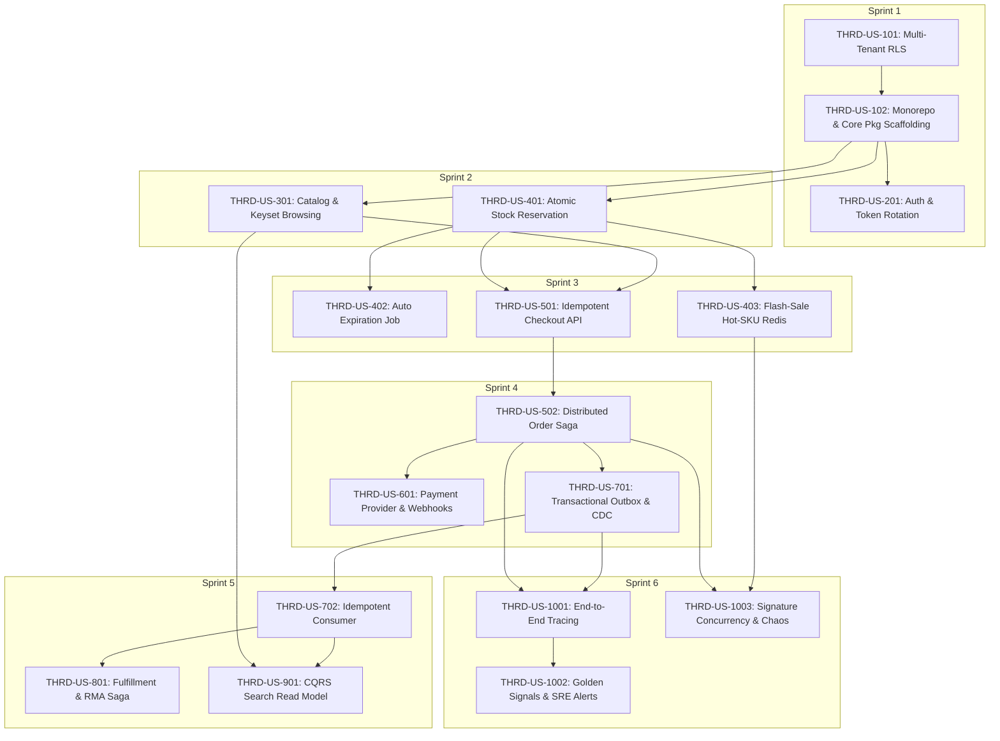

# THREADLINE — Agile Backlog & Engineering User Stories
> **Distributed Commerce Backend Platform**  
> Formatted according to Agile/Scrum standards with BDD Acceptance Criteria (Gherkin), Technical Architecture Context, Domain Invariants, and Granular Engineering Sub-Tasks.
> Aligned 100% with the binding Architectural Spine (`docs/architecture-threadline/architecture-threadline.md`).

---

## 1. Agile Framework & Governance Standards

### 1.1. Sprint Cadence & Story Point Sizing
- **Sprint Duration:** 2 weeks per Sprint (Total: 6 Sprints / 12 Weeks).
- **Estimation Scale:** Fibonacci Sequence (1, 2, 3, 5, 8, 13).
  - `1 - 2 SP`: Minor CRUD endpoint, schema tweak, simple config or metric probe.
  - `3 - 5 SP`: Standard use case across Hexagonal layers (Domain -> App -> Adapter -> HTTP/gRPC).
  - `8 SP`: Complex aggregate with strict concurrency control, distributed saga step, or CDC integration.
  - `13 SP`: System-level cross-cutting epic milestone (e.g., Flash-sale anti-oversell engine with Redis sharding + reconciliation).
- **MoSCoW Prioritization:**
  - **Must Have (M):** Core survival path (Scaffolding, RLS, Inventory, Saga, Outbox, CDC, Observability, 0-Oversell).
  - **Should Have (S):** Multi-tenant Catalog, Keyset Pagination, Idempotent Webhooks, OpenSearch CQRS.
  - **Could Have (C):** Returns/RMA Automation, Dynamic Pricing Engine, Polyglot service.
  - **Won't Have (W) [MVP]:** Full frontend UI, production 3PL/PSP integrations, ML recommendations.

### 1.2. Definition of Ready (DoR)
A story is ready for Sprint planning only when:
1. Business requirements and domain invariants are clearly stated with unambiguous boundary values.
2. Target microservice, bounded context, and governing Architecture Decisions (`AD-1` to `AD-12`) are identified.
3. API / Message contract draft exists (OpenAPI 3.1 or Protobuf / AsyncAPI).
4. Database schema impact and concurrency requirements (isolation level, locking mechanism, RLS scope) are defined.
5. Acceptance Criteria are written in executable Given-When-Then format.
6. External dependencies (mocks, testcontainers) are established.

### 1.3. Definition of Done (DoD)
A story is marked `DONE` only when:
1. **Architecture Enforcement:** Adheres to Hexagonal Architecture; domain layer imports only stdlib (`go-arch-lint` passes per **AD-10**).
2. **Code Quality:** Formatted via `gofumpt`, passes `golangci-lint` with zero warnings.
3. **Transaction Safety:** Zero remote I/O (HTTP/gRPC/Redis/Kafka) invoked inside open database transactions per **AD-7**.
4. **Test Pyramid Standards:**
   - Domain unit test coverage $\ge 90\%$ (deterministic, zero external I/O).
   - Application use-case coverage $\ge 80\%$.
   - Integration tests executed against real dependencies via Testcontainers (PostgreSQL, Redis, Kafka).
   - Concurrency stress tests assert zero race conditions (`-race` flag passed).
5. **API & Contract Safety:** Passes `oasdiff` / `buf breaking` checks to prevent breaking changes per **AD-12**.
6. **Observability:** Structured logs (`slog`) with propagated `trace_id`, custom Prometheus metrics, and OpenTelemetry spans across Kafka per **AD-9**.
7. **Security:** No hardcoded secrets (`gitleaks`), container runs as non-root (UID 65532), input whitelisted, RLS policies active.
8. **Documentation:** ADR / Spine updated if architectural trade-off was made; API spec committed.

---

## 2. Epics Overview & Sprint Roadmapping

| Epic ID | Epic Title | Target Sprint | Primary Service | Priority | Story Points |
|---|---|---|---|---|:---:|
| **EPC-01** | Multi-Tenant Platform & Hexagonal Core Scaffolding | Sprint 1 (W1) | `pkg/`, `gateway`, tooling | Must Have | 13 SP |
| **EPC-02** | Identity, Authentication & Token Family Lifecycle | Sprint 1 (W2) | `services/identity` | Must Have | 8 SP |
| **EPC-03** | Multi-Tenant Fashion Catalog & Keyset Browsing | Sprint 2 (W3) | `services/catalog` | Must Have | 8 SP |
| **EPC-04** | High-Contention Inventory & Zero-Oversell Engine ⭐ | Sprint 2-3 (W4-5) | `services/inventory` | Must Have (Signature) | 26 SP |
| **EPC-05** | Distributed Order Saga Orchestrator & State Machine ⭐ | Sprint 3-4 (W6-7) | `services/order` | Must Have (Signature) | 18 SP |
| **EPC-06** | Payment Integration & Idempotent Webhook Processing | Sprint 4 (W7) | `services/payment` | Must Have | 8 SP |
| **EPC-07** | Transactional Outbox, CDC & Kafka Streaming Backbone ⭐ | Sprint 4-5 (W8-9) | Platform / `pkg/outbox` | Must Have (Signature) | 13 SP |
| **EPC-08** | Multi-Warehouse Allocation & Reverse Logistics (RMA) | Sprint 5 (W9) | `services/fulfillment` | Should Have | 8 SP |
| **EPC-09** | CQRS Catalog Search & Read Model (OpenSearch) | Sprint 5 (W10) | `services/search` | Should Have | 8 SP |
| **EPC-10** | End-to-End Observability, SRE Alerts & Chaos Benchmark ⭐ | Sprint 6 (W11-12) | Cross-cutting / SRE | Must Have (Signature) | 26 SP |
| **TOTAL** | **Full 12-Week Delivery Scope** | **6 Sprints** | **All Services** | | **136 SP** |

---

## 3. Detailed User Stories & Engineering Sub-Tasks

---

### Epic 1: Multi-Tenant Platform & Hexagonal Core Scaffolding

#### US-1.1: Multi-Tenant Data Isolation with PostgreSQL Row-Level Security (RLS)
- **ID:** `THRD-US-101` | **Points:** `5 SP` | **Priority:** `Must Have`
- **Governing Architecture Invariants:** `AD-4` (PostgreSQL Multi-Tenant RLS & Fail-Closed Session Scope), `AD-6` (Logical Database-per-Service Isolation).
- **Role & Value:**
  - *As a* Platform Security Architect,
  - *I want* PostgreSQL to enforce Row-Level Security (RLS) on all multi-tenant tables using transaction-scoped session variables,
  - *So that* application queries can never leak cross-tenant data even if a developer forgets to append `WHERE tenant_id = $1`.

- **Technical Context & Invariants:**
  - Every connection pool checkout must execute `SET LOCAL app.tenant_id = '<current_tenant>'` strictly inside an active transaction.
  - Superuser bypasses RLS; therefore, microservice DB users must be created without `BYPASSRLS`.
  - Background workers must **not** possess `BYPASSRLS` privileges; they must iterate tenants sequentially with explicit `SET LOCAL` per batch.

- **Acceptance Criteria (BDD):**
  - **Scenario 1: Authorized Tenant Query Execution**
    - *Given* database contains orders for tenant `zalora-vn` and tenant `iconic-au`
    - *When* a transaction sets `SET LOCAL app.tenant_id = 'zalora-vn'` and queries `SELECT * FROM orders`
    - *Then* only orders matching `tenant_id = 'zalora-vn'` are returned.
  - **Scenario 2: Unset Tenant Context Defense (Fail-Closed)**
    - *Given* a database connection where `app.tenant_id` has not been set
    - *When* any query on `orders` is executed
    - *Then* zero rows are returned (fail-closed security).
  - **Scenario 3: Cross-Tenant Data Injection Prevention**
    - *Given* an active transaction set to `tenant_id = 'zalora-vn'`
    - *When* an `INSERT INTO orders (id, tenant_id, ...) VALUES (..., 'iconic-au', ...)` is attempted
    - *Then* PostgreSQL rejects the statement with RLS violation error `42501`.

- **Sub-tasks Breakdown:**
  - [x] `[Adapters/DB]` Write base migration enabling RLS: `ALTER TABLE ... ENABLE ROW LEVEL SECURITY` and define `tenant_isolation` policies.
  - [x] `[Adapters/DB]` Create unprivileged PostgreSQL roles for each microservice with restricted grants (no `BYPASSRLS`).
  - [x] `[Application/Ports]` Implement `TenantContext` interface in Go stdlib `context.Context` propagation.
  - [x] `[Adapters/Postgres]` Write `pgxpool` transaction hook / middleware to execute `SET LOCAL app.tenant_id` on transaction start.
  - [x] `[Testing]` Create Testcontainers PostgreSQL integration test verifying cross-tenant isolation and fail-closed defaults.

---

#### US-1.2: Multi-Module Monorepo Scaffolding, Core Shared Packages & Architectural Linter ⭐
- **ID:** `THRD-US-102` | **Points:** `8 SP` | **Priority:** `Must Have`
- **Governing Architecture Invariants:** `AD-1` (Multi-Module Monorepo with Go Workspaces), `AD-10` (Domain Purity Invariant), `AD-12` (RFC 7807 Error Taxonomy).
- **Role & Value:**
  - *As a* Lead Platform Engineer,
  - *I want* a standardized multi-module monorepo using `go.work`, shared foundation packages (`pkg/`), architecture boundary linters, and a local Docker Compose infrastructure stack,
  - *So that* developers can spin up the full platform in under 3 minutes (`make dev`) with guaranteed zero dependency bloat and strict hexagonal layer separation.

- **Technical Context & Invariants:**
  - Root workspace uses `go.work` linking `pkg/` and all 6 services.
  - Shared package `pkg/` must contain: `httpx` (RFC 7807 error formatter), `grpcx` (interceptor suite), `observability` (slog + OTel SDK), `rls` (pgx transaction hook), `idempotency` (middleware), `outbox` (writer interface).
  - Architecture enforcement: CI executes `go-arch-lint` / `depguard` ensuring `domain/` packages import only Go stdlib.
  - Local Dev Stack: Docker Compose running PostgreSQL (multi-database setup), Redis 7, Kafka (KRaft mode, zero Zookeeper), OpenTelemetry Collector, and LocalStack.

- **Acceptance Criteria (BDD):**
  - **Scenario 1: Clean Local Bootstrap Under 3 Minutes**
    - *Given* a clean developer workstation with Docker installed
    - *When* running `make dev`
    - *Then* all infrastructure dependencies (PostgreSQL, Redis, Kafka, OTel) pass health checks in < 180 seconds.
  - **Scenario 2: Architectural Boundary Linter Rejection**
    - *Given* a developer accidentally imports `github.com/jackc/pgx/v5` into `internal/domain/stock/stock_item.go`
    - *When* running `make lint` or CI triggers
    - *Then* `go-arch-lint` fails with a non-zero exit code reporting an illegal layer dependency.
  - **Scenario 3: Standard RFC 7807 Problem Details Response**
    - *Given* an HTTP handler returns an application error via `httpx.WriteProblemDetails`
    - *When* inspected by the client
    - *Then* response has `Content-Type: application/problem+json` containing `type`, `title`, `status`, `code`, `detail`, and `trace_id`.

- **Sub-tasks Breakdown:**
  - [x] `[Tooling]` Initialize `go.work` linking `pkg/` and initial service directories.
  - [x] `[Pkg/Httpx]` Implement standard middleware: RequestID, Recoverer, RealIP, TenantContext, and RFC 7807 Problem Details writer.
  - [x] `[Pkg/Observability]` Implement JSON `log/slog` handler with W3C `traceparent` context enrichment and OTel TracerProvider.
  - [x] `[Pkg/Rls]` Implement reusable `pgxpool` transaction manager injecting `SET LOCAL app.tenant_id`.
  - [x] `[Tooling/CI]` Configure `.golangci.yml` and `go-arch-lint.yaml` enforcing Domain Purity.
  - [x] `[Deploy/Compose]` Author `docker-compose.yml` with PostgreSQL (multi-tenant init scripts), Redis 7, Kafka KRaft, and OTel Collector.
  - [x] `[Makefile]` Author `Makefile` with targets: `dev`, `test`, `lint`, `clean`.

---

### Epic 2: Identity & Access Management

#### US-2.1: Refresh Token Family Rotation & Active Reuse Detection
- **ID:** `THRD-US-201` | **Points:** `8 SP` | **Priority:** `Must Have`
- **Governing Architecture Invariants:** `AD-4` (Multi-Tenant RLS), `AD-8` (Strict Idempotency), `AD-12` (RFC 7807 Error Details).
- **Role & Value:**
  - *As a* Customer,
  - *I want* my session refresh tokens to rotate on every use with immediate breach detection,
  - *So that* intercepted refresh tokens cannot be used by malicious actors without revoking the compromised session family.

- **Technical Context & Invariants:**
  - OAuth 2.0 Security Best Current Practice (BCP).
  - Refresh tokens stored as SHA-256 hashes inside Redis with metadata `{family_id, jti, used: bool}`.
  - If a token marked `used = true` is presented, treat as active intrusion -> revoke entire `family_id` immediately.

- **Acceptance Criteria (BDD):**
  - **Scenario 1: Legitimate Token Refresh Rotation**
    - *Given* a user has valid `RT-1` belonging to family `F-1`
    - *When* the user requests `/v1/auth/refresh` with `RT-1`
    - *Then* system returns a new short-lived JWT (15 min) and `RT-2`, marking `RT-1` as `used`.
  - **Scenario 2: Malicious Replay of Already-Used Token**
    - *Given* `RT-1` was already exchanged for `RT-2`
    - *When* an attacker attempts to call `/v1/auth/refresh` using `RT-1`
    - *Then* system returns `401 Unauthorized`, revokes family `F-1` (blacklisting `RT-2`), and logs an `A07_TOKEN_REUSE` security alert.

- **Sub-tasks Breakdown:**
  - [x] `[Domain]` Design `TokenFamily` entity and state transitions (`Active`, `Rotated`, `Compromised`).
  - [x] `[Adapters/Redis]` Implement atomic Lua script for token exchange and reuse detection.
  - [ ] `[Application]` Implement `RefreshTokenUseCase` with audit logging of client IP, User-Agent, and geographic hash.
  - [ ] `[Ports/HTTP]` Expose `POST /v1/auth/refresh` with `SameSite=Strict; HttpOnly; Secure` cookie handling.
  - [ ] `[Testing]` Unit test domain logic and Testcontainers Redis integration test simulating concurrent replay attacks.

---

### Epic 3: Multi-Tenant Fashion Catalog & Keyset Browsing

#### US-3.1: Multi-Tenant Fashion Catalog, Dynamic Variant Attributes & Keyset Pagination ⭐
- **ID:** `THRD-US-301` | **Points:** `8 SP` | **Priority:** `Must Have`
- **Governing Architecture Invariants:** `AD-4` (Multi-Tenant RLS), `AD-11` (Expand-Contract Zero-Downtime Migration), `AD-12` (RFC 7807 & Keyset Pagination).
- **Role & Value:**
  - *As an* E-commerce Shopper,
  - *I want* to browse fashion products with size/color variants and cursor-based pagination,
  - *So that* catalog browsing is stable, ultra-fast ($p99 < 80\text{ms}$), and isolated to my country/tenant storefront without offset performance degradation.

- **Technical Context & Invariants:**
  - Products have $N$ variants (SKUs) based on size, color, and dynamic attributes stored as PostgreSQL `JSONB`.
  - Categories organized via hierarchical tree (`ltree` or closure table).
  - Keyset pagination required: `WHERE (placed_at, id) < ($cursor_time, $cursor_id) ORDER BY placed_at DESC, id DESC LIMIT $limit + 1`. Offset pagination forbidden for public APIs.
  - Multi-tenant catalog publishing: A product may exist globally, but publish status and pricing are scoped strictly per tenant.

- **Acceptance Criteria (BDD):**
  - **Scenario 1: Stable Keyset Browsing Across Pages**
    - *Given* 100,000 products in tenant `zalora-vn`
    - *When* client requests `GET /v1/products?limit=24` followed by cursor query with `next_cursor`
    - *Then* second page returns in $< 30\text{ms}$ without skipping or duplicating items, even if new products were inserted concurrently.
  - **Scenario 2: Tenant Publication Isolation**
    - *Given* product `PRD-1` is published for `zalora-vn` but unpublished for `iconic-au`
    - *When* a request with `X-Tenant-ID: iconic-au` queries `/v1/products/PRD-1`
    - *Then* API returns `404 Not Found`.

- **Sub-tasks Breakdown:**
  - [ ] `[Domain]` Model `Product`, `ProductVariant` (SKU), and `Category` aggregates with domain invariants.
  - [ ] `[Adapters/DB]` Author PostgreSQL migrations for `products`, `product_variants`, `categories` with GIN indexes on JSONB attributes.
  - [ ] `[Adapters/DB]` Implement `sqlc` queries utilizing keyset pagination `(created_at, id)` composite indexing.
  - [ ] `[Application]` Implement `ListProductsUseCase` with cursor encoding/decoding (`base64`).
  - [ ] `[Ports/HTTP]` Expose `GET /v1/products` and `GET /v1/products/{id}` with ETag and `Cache-Control: public, max-age=60`.
  - [ ] `[Testing]` Testcontainers integration test with 10,000 seeded items asserting keyset pagination correctness.

---

### Epic 4: High-Contention Inventory & Anti-Overselling Engine ⭐ (Core Signature)

#### US-4.1: Atomic Conditional Stock Reservation with Zero-Oversell Guarantee
- **ID:** `THRD-US-401` | **Points:** `8 SP` | **Priority:** `Must Have (Signature)`
- **Governing Architecture Invariants:** `AD-2` (Zero-Oversell via Atomic SQL), `AD-7` (Zero Remote I/O in DB Tx), `AD-10` (Domain Purity Invariant).
- **Role & Value:**
  - *As an* Inventory Domain Controller,
  - *I want* to reserve inventory stock using atomic database-guarded conditional updates,
  - *So that* concurrent checkout requests can never result in overselling (`available < 0`), eliminating race conditions without manual table locks.

- **Technical Context & Invariants:**
  - Business Rule `BR-02`: `available = on_hand - reserved - damaged >= 0`.
  - Concurrency mechanism: Single-trip SQL `UPDATE stock_items ... WHERE (on_hand - reserved - damaged) >= $qty RETURNING version`.
  - Invariant enforced at database level via `CONSTRAINT chk_available_ge_zero`.
  - Multi-item deadlock prevention: Pre-sort all reservation items by `stock_item_id ASC` before acquiring row locks per **AD-2**.
  - Zero remote network I/O executed inside database transaction per **AD-7**.

- **Acceptance Criteria (BDD):**
  - **Scenario 1: Successful Stock Reservation**
    - *Given* SKU `TSHIRT-BLK-M` in warehouse `WH-01` has `on_hand = 10`, `reserved = 0`, `damaged = 0`
    - *When* a reservation request arrives for `qty = 3` with `order_id = ORD-100`
    - *Then* `reserved` becomes `3`, a reservation record is created with TTL 15 minutes, and domain event `StockReserved` is registered.
  - **Scenario 2: Insufficient Stock Rejection**
    - *Given* SKU `TSHIRT-BLK-M` has `on_hand = 5`, `reserved = 4`, `damaged = 0` (available = 1)
    - *When* a reservation request arrives for `qty = 2`
    - *Then* SQL update returns `0 rows affected`, transaction rolls back, and API returns `409 Conflict (INVENTORY_INSUFFICIENT)`.
  - **Scenario 3: 500 Concurrent goroutines contesting 100 units**
    - *Given* SKU `HOT-SKU` has initial available stock of `100`
    - *When* 500 concurrent goroutines attempt to reserve `1` unit each
    - *Then* exactly 100 requests succeed, 400 requests fail with `409 Conflict`, and final `reserved == 100` with 0 oversell.

- **Sub-tasks Breakdown:**
  - [ ] `[Domain]` Model `StockItem` Aggregate Root with private fields, `Reserve()`, `Release()`, `Commit()` methods enforcing invariants.
  - [ ] `[Adapters/DB]` Write PostgreSQL migrations for `stock_items`, `reservations`, and `reservation_items` with covering indices.
  - [ ] `[Adapters/DB]` Implement `sqlc` queries with atomic conditional guards and `RETURNING version`.
  - [ ] `[Application]` Implement `ReserveStockUseCase` enforcing dead-lock sorting on multi-item requests.
  - [ ] `[Ports/gRPC]` Expose internal gRPC endpoint `InventoryService.ReserveStock` with Protobuf contract.
  - [ ] `[Testing/Concurrency]` Write signature Testcontainers concurrency test with 500 parallel workers verifying zero oversell.
  - [ ] `[Observability]` Add Prometheus metric `inventory_reservations_total{result="success|insufficient"}` and span tracking.

---

#### US-4.2: Automated Reservation Expiration & Stock Release Background Job
- **ID:** `THRD-US-402` | **Points:** `5 SP` | **Priority:** `Must Have`
- **Governing Architecture Invariants:** `AD-4` (Multi-Tenant RLS with sequential tenant iteration, zero `BYPASSRLS`), `AD-7` (Zero Remote I/O in DB Tx).
- **Role & Value:**
  - *As an* E-commerce Operations Manager,
  - *I want* inventory reservations to expire automatically after 15 minutes if not committed,
  - *So that* abandoned carts do not hold inventory hostage from paying customers.

- **Technical Context & Invariants:**
  - Business Rule `BR-01`: Reservations hold stock for 15 minutes max.
  - Partial index optimization: `CREATE INDEX idx_reservation_expiry ON reservations (expires_at) WHERE status = 'ACTIVE'`.
  - Background worker does **not** have `BYPASSRLS` privileges per **AD-4**; it queries active tenant IDs and executes batch cleanups per tenant inside discrete transactions.

- **Acceptance Criteria (BDD):**
  - **Scenario 1: Expired Reservation Reclamation**
    - *Given* reservation `RES-1` was created at `T-16m` with `status = ACTIVE` holding 2 units of `SKU-A`
    - *When* the expiry worker runs
    - *Then* `RES-1` status transitions to `EXPIRED`, `stock_items.reserved` decreases by 2, and `stock_movements` logs a `RELEASE` event.
  - **Scenario 2: Active Reservation Ignored**
    - *Given* reservation `RES-2` created at `T-5m` with `expires_at = T+10m`
    - *When* the expiry worker runs
    - *Then* `RES-2` remains untouched in `ACTIVE` state.

- **Sub-tasks Breakdown:**
  - [ ] `[Adapters/DB]` Create partial index for `reservations.expires_at WHERE status = 'ACTIVE'`.
  - [ ] `[Application]` Implement `ExpireReservationsUseCase` with batched chunking (100 reservations per transaction).
  - [ ] `[Adapters/Worker]` Build background worker ticker with distributed leader election using Postgres advisory locks.
  - [ ] `[Testing]` Write integration test using `Clock` port abstraction to advance simulated time without `time.Sleep`.
  - [ ] `[Observability]` Export metric `inventory_reservations_expired_total`.

---

#### US-4.3: Flash-Sale Hot-SKU Token Bucket & Sharded Counter
- **ID:** `THRD-US-403` | **Points:** `13 SP` | **Priority:** `Must Have (Signature)`
- **Governing Architecture Invariants:** `AD-2` (Scheduled Hot-SKU Pre-Warming & Sharded Counter), `AD-7` (Zero Remote I/O in DB Tx).
- **Role & Value:**
  - *As a* High-Traffic Platform Engineer,
  - *I want* hot flash-sale SKUs pre-warmed into Redis sharded token counters prior to campaigns,
  - *So that* the platform sustains 10,000 requests/sec with p99 < 50ms without degrading database connection pools or causing runtime split-brain.

- **Technical Context & Invariants:**
  - Per **AD-2**, hot SKUs are scheduled and pre-warmed via admin configuration prior to campaign start (dynamic in-flight migration is forbidden).
  - 10 shards per hot SKU in Redis (e.g., 1000 stock = 10 buckets $\times$ 100).
  - Client request hashes into shard based on `hash(user_id) % 10`.
  - Redis Lua script executes atomic decrement and idempotency check.
  - Reconciliation worker reconciles Redis state against PostgreSQL ledger every 30 seconds; alert if `stock_drift_total > 0`.

- **Acceptance Criteria (BDD):**
  - **Scenario 1: Atomic Sharded Redis Decrement**
    - *Given* SKU `FLASH-DRESS` is flagged in Hot SKU mode with 10 shards of 10 units each
    - *When* user `USR-123` requests 1 unit
    - *Then* user's designated shard decrements by 1 atomically in Redis, returning success in < 5ms.
  - **Scenario 2: Overflow Shard Failover**
    - *Given* user's primary shard has 0 units remaining but other shards retain stock
    - *When* user attempts reservation
    - *Then* Lua script falls over to adjacent shard (max 2 hops) and succeeds without false out-of-stock.
  - **Scenario 3: Background Reconciliation Safety**
    - *Given* Redis processed 500 decrements
    - *When* the reconciliation job runs at T+30s
    - *Then* PostgreSQL stock ledger movements match Redis decrements exactly with 0 drift.

- **Sub-tasks Breakdown:**
  - [ ] `[Adapters/Redis]` Author and unit-test Lua script `reserve.lua` supporting sharding and idempotency keys.
  - [ ] `[Application]` Implement scheduled pre-warm CLI / Admin usecase syncing PostgreSQL available stock into Redis shards.
  - [ ] `[Adapters/Worker]` Build reconciliation worker syncing Redis counts to PostgreSQL audit ledger.
  - [ ] `[Testing/k6]` Author k6 flash sale scenario simulating 10,000 Virtual Users competing for 100 units.
  - [ ] `[Observability]` Add Prometheus metric `stock_drift_total` and configure pager alert.

---

### Epic 5: Distributed Order Saga Orchestrator & State Machine ⭐ (Core Signature)

#### US-5.1: Asynchronous Idempotent Checkout Initiation (HTTP 202 Accepted)
- **ID:** `THRD-US-501` | **Points:** `5 SP` | **Priority:** `Must Have`
- **Governing Architecture Invariants:** `AD-8` (Strict Idempotency with Payload Hashing & In-Flight Mutex), `AD-12` (RFC 7807 & HTTP 202 Async Checkout).
- **Role & Value:**
  - *As an* API Client / Storefront,
  - *I want* to initiate checkout with an `Idempotency-Key` and receive an immediate `202 Accepted` response,
  - *So that* high-concurrency checkout spikes are decoupled from downstream payment and inventory latency.

- **Technical Context & Invariants:**
  - Target latency: p99 < 300ms.
  - Header: `Idempotency-Key: <UUIDv7>`.
  - Idempotency table: `idempotency_keys(key, tenant_id, request_hash, state, response_body)`.
  - Mismatched request hash for identical key -> return `422 Unprocessable Entity` per **AD-8**.
  - Concurrent duplicate submission while `IN_PROGRESS` -> return `409 Conflict` per **AD-8**.

- **Acceptance Criteria (BDD):**
  - **Scenario 1: Fresh Checkout Request**
    - *Given* a valid cart and new `Idempotency-Key: KEY-1`
    - *When* client invokes `POST /v1/checkout`
    - *Then* order is persisted in `CREATED` status, Saga instance is initiated, and client receives `202 Accepted` with `order_id` and status URL.
  - **Scenario 2: Concurrent Duplicate Checkout Submission**
    - *Given* request with `Idempotency-Key: KEY-1` is currently `IN_PROGRESS`
    - *When* identical request arrives concurrently with `Idempotency-Key: KEY-1`
    - *Then* API rejects immediately with `409 Conflict`.
  - **Scenario 3: Payload Tampering with Reused Key**
    - *Given* `KEY-1` was submitted with `total = 500000`
    - *When* a subsequent request arrives with `KEY-1` but `total = 200000`
    - *Then* API rejects immediately with `422 Unprocessable Entity` (`IDEMPOTENCY_KEY_REUSED_WITH_DIFFERENT_PAYLOAD`).

- **Sub-tasks Breakdown:**
  - [ ] `[Domain]` Define `Order` aggregate root and `OrderStatus` finite state machine.
  - [ ] `[Adapters/DB]` Create partitioned `orders` and `order_items` tables with `idempotency_keys` table.
  - [ ] `[Application]` Implement idempotent checkout command handler with transactional outbox event creation.
  - [ ] `[Ports/HTTP]` Expose `POST /v1/checkout` returning RFC 7807 problem details on validation failure.
  - [ ] `[Testing]` Write parallel integration test asserting identical response across duplicate submissions and 422 on payload tamper.

---

#### US-5.2: Distributed Order Saga Orchestrator with Compensating Transactions
- **ID:** `THRD-US-502` | **Points:** `13 SP` | **Priority:** `Must Have (Signature)`
- **Governing Architecture Invariants:** `AD-3` (Saga Pivot Transaction & Retry-Forward-Only), `AD-7` (Zero Remote I/O in DB Tx), `AD-10` (Domain Purity).
- **Role & Value:**
  - *As an* Order Processing Engine,
  - *I want* an orchestrator-based Saga to coordinate Stock Reservation, Payment Authorization, and Shipment Allocation,
  - *So that* any partial downstream failure triggers compensating transactions, guaranteeing distributed eventual consistency.

- **Technical Context & Invariants:**
  - Orchestrator pattern (state stored in `saga_instances` & `saga_steps`).
  - Pivot step: `Payment Capture`. Prior to capture, failures trigger rollback (Release Stock). Post capture, saga switches to **Retry-Forward-Only** per **AD-3** (automated refund prohibited).
  - Resilience: Stuck saga detector (`saga_stuck_total`) alerts if saga remains active > 5 minutes.
  - Database transactions open only to update step state locally; gRPC calls execute outside transactions per **AD-7**.

- **Saga Step Matrix:**
  | Step | Target Service | Forward Action | Compensating Action | Idempotency Key | Failure Semantic |
  |---|---|---|---|---|---|
  | 1 | `inventory-service` | `ReserveStock` (gRPC) | `ReleaseStock` (gRPC) | `order_id` | Compensate / Rollback |
  | 2 | `payment-service` | `AuthorizeAndCapture` (gRPC) | `Void / Refund` (gRPC) | `order_id` | **PIVOT TRANSACTION** |
  | 3 | `inventory-service` | `CommitStock` (gRPC) | *Prohibited* (Manual DLQ) | `order_id` | **Retry-Forward-Only** |
  | 4 | `fulfillment-service`| `CreateShipment` (Kafka) | *Prohibited* (Manual DLQ) | `order_id` | **Retry-Forward-Only** |

- **Acceptance Criteria (BDD):**
  - **Scenario 1: Happy Path Saga Completion**
    - *Given* order `ORD-1` initiated in `CREATED` state
    - *When* Saga successfully reserves stock and captures payment
    - *Then* order transitions `PAID`, emits `OrderPaid` domain event, commits inventory, and completes in < 3s p95.
  - **Scenario 2: Payment Failure Triggering Automatic Compensation**
    - *Given* stock was successfully reserved for order `ORD-2`
    - *When* payment authorization is declined by PSP
    - *Then* Saga calls `ReleaseStock(order_id=ORD-2)`, transitions order to `PAYMENT_FAILED`, and verifies stock is restored.
  - **Scenario 3: Post-Pivot Failure Enforcing Retry-Forward-Only**
    - *Given* payment was captured successfully for `ORD-3`
    - *When* network to `inventory-service` drops during `CommitStock`
    - *Then* Saga does **not** refund payment; it schedules exponential retries and diverts to DLQ if permanent.
  - **Scenario 4: Orchestrator Pod Crash Recovery**
    - *Given* Saga is executing between Step 1 and Step 2
    - *When* the `order-service` pod is abruptly killed (`SIGKILL`)
    - *Then* upon restart, Saga recovery worker inspects `saga_instances` table, resumes execution from last checkpoint, and completes successfully.

- **Sub-tasks Breakdown:**
  - [ ] `[Domain]` Model `SagaInstance` and `SagaStep` state machine with retry policies and compensation definitions.
  - [ ] `[Adapters/DB]` Create DDL and repository for `saga_instances` and `saga_steps`.
  - [ ] `[Application]` Implement `OrderSagaOrchestrator` invoking gRPC clients outside DB transactions with context deadlines.
  - [ ] `[Adapters/gRPC]` Write gRPC clients for `inventory-service` and `payment-service`.
  - [ ] `[Application]` Build recovery worker scanning for abandoned sagas older than 2 minutes.
  - [ ] `[Testing/Chaos]` Test pod termination midway through saga execution asserting stateful resumption.
  - [ ] `[Observability]` Emit metrics `saga_duration_seconds`, `saga_compensations_total`, and `saga_stuck_total`.

---

### Epic 6: Payment Processing & Idempotent Webhook Engine

#### US-6.1: Hexagonal Payment Provider Adapter & Idempotent Webhook Ingestion
- **ID:** `THRD-US-601` | **Points:** `8 SP` | **Priority:** `Must Have`
- **Governing Architecture Invariants:** `AD-3` (Payment Capture Pivot), `AD-8` (Strict Idempotency), `AD-12` (RFC 7807 Error Details).
- **Role & Value:**
  - *As a* Financial Platform Engineer,
  - *I want* payment integrations structured via Hexagonal Ports & Adapters with idempotent HMAC webhook ingestion,
  - *So that* switching payment service providers (e.g., Stripe to Adyen) requires zero domain alterations, and duplicate webhooks never double-charge.

- **Technical Context & Invariants:**
  - Domain Port: `PaymentProvider` interface with methods `Authorize`, `Capture`, `Void`, `Refund`.
  - Webhook security: HMAC SHA-256 signature verification.
  - Business Rule `BR-07`: `sum(refunds) <= captured_amount` enforced under `Repeatable Read` isolation.

- **Acceptance Criteria (BDD):**
  - **Scenario 1: Verified Webhook Processing**
    - *Given* a valid PSP webhook payload with correct `X-Signature-SHA256`
    - *When* received at `POST /v1/webhooks/payments/stripe`
    - *Then* payload is stored in `raw_webhooks`, payment status transitions to `CAPTURED`, and event `PaymentCaptured` is emitted via Outbox.
  - **Scenario 2: Duplicate Webhook Replay Immunity**
    - *Given* webhook with `event_id = EVT-999` was already processed
    - *When* identical webhook is re-delivered by the PSP
    - *Then* endpoint returns `200 OK` immediately without re-triggering business logic.
  - **Scenario 3: Tampered Signature Rejection**
    - *Given* a webhook with forged payload or invalid HMAC header
    - *When* received at the webhook endpoint
    - *Then* request is rejected with `401 Unauthorized` and raw attempt is audited.

- **Sub-tasks Breakdown:**
  - [ ] `[Domain]` Define `Payment` aggregate root enforcing valid state transitions and refund limits.
  - [ ] `[Application/Ports]` Define `PaymentProvider` driving port interface.
  - [ ] `[Adapters/PSP]` Implement `StripeMock` and `LocalWalletMock` adapters fulfilling the port.
  - [ ] `[Ports/HTTP]` Expose webhook handler with constant-time HMAC signature verification and deduplication filter.
  - [ ] `[Testing]` WireMock integration tests asserting mock PSP contract compatibility and duplicate webhook resistance.

---

### Epic 7: Event-Driven Infrastructure & Transactional Outbox

#### US-7.1: Transactional Outbox Pattern with Zero-Loss CDC Relay
- **ID:** `THRD-US-701` | **Points:** `8 SP` | **Priority:** `Must Have (Signature)`
- **Governing Architecture Invariants:** `AD-7` (Zero Remote I/O in DB Tx), `AD-9` (End-to-End W3C Trace Context in Outbox Headers).
- **Role & Value:**
  - *As a* Distributed Systems Architect,
  - *I want* domain events written atomically to an `outbox_events` table and relayed to Kafka via Debezium CDC,
  - *So that* dual-write anomalies are eliminated, ensuring zero event loss during network splits with W3C trace continuity.

- **Technical Context & Invariants:**
  - Dual-write elimination: Business data update and outbox insertion occur in the exact same PostgreSQL transaction per **AD-7**.
  - Trace propagation: W3C `traceparent` stored in outbox `headers` JSONB column and mapped to Kafka record headers per **AD-9**.
  - Debezium PostgreSQL connector streams events directly from WAL to MSK Kafka; local dev utilizes fallback background poller worker.

- **Acceptance Criteria (BDD):**
  - **Scenario 1: Atomic Outbox Persistence**
    - *Given* an order is created
    - *When* database transaction commits
    - *Then* both `orders` record and corresponding `OrderCreated` in `outbox_events` exist simultaneously.
  - **Scenario 2: Transaction Rollback Integrity**
    - *Given* order creation fails due to validation error
    - *When* database transaction aborts
    - *Then* no record is written to `outbox_events` (zero orphan events).
  - **Scenario 3: Kafka Outage Resilience (Chaos Drill)**
    - *Given* Kafka brokers are paused for 60 seconds
    - *When* checkout orders continue processing
    - *Then* outbox table accumulates events safely, and upon Kafka recovery, all events publish in order with 0 loss.

- **Sub-tasks Breakdown:**
  - [ ] `[Adapters/DB]` Create `outbox_events` table with partial index `WHERE published_at IS NULL`.
  - [ ] `[Pkg/Outbox]` Implement reusable `outbox.Writer` recording domain events with W3C `traceparent` context.
  - [ ] `[Deploy/CDC]` Configure Debezium connector manifest for Kafka Connect / MSK Connect.
  - [ ] `[Adapters/Worker]` Build fallback polling publisher worker for local docker-compose development.
  - [ ] `[Testing/Chaos]` Write chaos test stopping Kafka broker for 60s asserting zero lost events.
  - [ ] `[Observability]` Export Prometheus gauge `outbox_unpublished_age_seconds`.

---

#### US-7.2: Effectively-Once Kafka Consumer Framework
- **ID:** `THRD-US-702` | **Points:** `5 SP` | **Priority:** `Must Have`
- **Governing Architecture Invariants:** `AD-5` (Entity-Scoped Kafka Partition Key Strategy), `AD-9` (Trace Context Extraction).
- **Role & Value:**
  - *As an* Asynchronous Worker Service,
  - *I want* consumers to track message processing in a `processed_events` table and route by entity partition keys,
  - *So that* Kafka's at-least-once delivery guarantees translate into effectively-once execution with zero partition skew.

- **Technical Context & Invariants:**
  - Deduplication table: `processed_events(event_id UUID, consumer_group TEXT, processed_at TIMESTAMPTZ, PRIMARY KEY(event_id, consumer_group))`.
  - Ordering: Kafka partition key set strictly to entity ID (`order_id`, `sku`) per **AD-5**. Keying by `tenant_id` is forbidden.
  - Consumer extracts W3C `traceparent` from Kafka record headers and resumes child span per **AD-9**.

- **Acceptance Criteria (BDD):**
  - **Scenario 1: First-Time Event Consumption**
    - *Given* event `OrderPaid` with `id = EVT-10`
    - *When* consumer group `fulfillment-worker` processes the message
    - *Then* shipment is generated and `(EVT-10, 'fulfillment-worker')` is recorded.
  - **Scenario 2: Duplicate Redelivery Handled Safely**
    - *Given* event `EVT-10` was already processed
    - *When* Kafka redelivers `EVT-10` due to rebalance
    - *Then* consumer detects duplicate key, skips processing, and commits offset immediately.

- **Sub-tasks Breakdown:**
  - [ ] `[Pkg/Kafka]` Build generic idempotent consumer wrapper utilizing PostgreSQL deduplication table and W3C trace extractor.
  - [ ] `[Application]` Implement consumer handler for `OrderPaid` -> Trigger Fulfillment Allocation.
  - [ ] `[Testing]` Write integration test injecting identical event twice verifying single execution.
  - [ ] `[Observability]` Export metric `kafka_consumer_lag{topic, group}`.

---

### Epic 8: Fulfillment Allocation & Reverse Logistics (Returns/RMA)

#### US-8.1: Reverse Logistics RMA Lifecycle & Inspection-Triggered Auto-Refund Saga
- **ID:** `THRD-US-801` | **Points:** `8 SP` | **Priority:** `Should Have`
- **Governing Architecture Invariants:** `AD-3` (Saga Retry-Forward-Only), `AD-5` (Entity Partition Key), `AD-9` (Distributed Tracing).
- **Role & Value:**
  - *As an* E-commerce Customer and Warehouse Inspector,
  - *I want* an automated return request (RMA) workflow that triggers refunds and restocks upon physical item inspection,
  - *So that* fashion return volumes (30-40% return rate) are processed efficiently within a 24-hour SLA.

- **Technical Context & Invariants:**
  - Business Rule `BR-05`: Only orders in `DELIVERED` state can initiate a return.
  - Business Rule `BR-06`: Return window $\le 30$ days from delivery.
  - Business Rule `BR-07`: Inspection status `ACCEPTED` initiates restock movement and refund saga.

- **Acceptance Criteria (BDD):**
  - **Scenario 1: Valid Return Request Submission**
    - *Given* order `ORD-1` delivered 10 days ago
    - *When* customer submits return request with reason and photos
    - *Then* system creates `ReturnRequest` in `PENDING_INSPECTION` state and generates return shipping label.
  - **Scenario 2: Warehouse Inspection & Automated Refund Execution**
    - *Given* returned parcel arrives at warehouse
    - *When* inspector submits `status = ACCEPTED, condition = RESTOCKABLE`
    - *Then* inventory increments `on_hand`, `payment-service` issues refund, and customer receives confirmation.
  - **Scenario 3: Return Window Expiration Rejection**
    - *Given* order delivered 35 days ago
    - *When* customer attempts return request
    - *Then* API rejects with `422 Unprocessable Entity (RETURN_WINDOW_EXPIRED)`.

- **Sub-tasks Breakdown:**
  - [ ] `[Domain]` Implement `ReturnRequest` aggregate root with state machine (`Requested`, `Inspected`, `Refunded`, `Rejected`).
  - [ ] `[Adapters/DB]` Add tables `return_requests` and `return_items`.
  - [ ] `[Application]` Implement `InspectReturnItemUseCase` emitting `ReturnAccepted` event.
  - [ ] `[Application/Saga]` Implement `RefundSaga` coordinating PSP refund and Inventory restock.
  - [ ] `[Testing]` Unit test state machine invariants and integration test full return-to-refund lifecycle.

---

### Epic 9: CQRS Catalog Search & Read Model (OpenSearch)

#### US-9.1: Event-Driven OpenSearch Ingestion & Sub-100ms Faceted Search
- **ID:** `THRD-US-901` | **Points:** `8 SP` | **Priority:** `Should Have`
- **Governing Architecture Invariants:** `AD-5` (Entity Partition Key), `AD-9` (Distributed Tracing).
- **Role & Value:**
  - *As a* Shopper,
  - *I want* to search products with typo tolerance and faceted filtering (size, color, brand, price) with p99 < 100ms,
  - *So that* I discover relevant items instantly without loading the primary transactional database.

- **Technical Context & Invariants:**
  - CQRS Read Model decoupled via Kafka event consumer.
  - Multi-locale analyzers (Vietnamese, English, Portuguese).
  - Out-of-stock items automatically demoted or hidden via `StockChanged` event stream.
  - Zero-downtime index migrations via OpenSearch index aliases (`products_v1 -> products_v2`).

- **Acceptance Criteria (BDD):**
  - **Scenario 1: Full-Text Search with Typo Tolerance**
    - *Given* indexed product "Áo thun cotton Oversize"
    - *When* customer queries `q=ao thun cotn`
    - *Then* product is returned in top results within < 50ms.
  - **Scenario 2: Faceted Filtering & Inventory Awareness**
    - *Given* products filtered by `brand=nike&size=M&in_stock=true`
    - *When* search endpoint is queried
    - *Then* only matching variants with active stock are returned, with facet counts calculated.

- **Sub-tasks Breakdown:**
  - [ ] `[Adapters/OpenSearch]` Define index mapping with multi-locale custom analyzers and ngram tokenizers.
  - [ ] `[Application/Worker]` Build Kafka consumer ingesting `ProductUpdated` and `StockChanged` events into bulk batches.
  - [ ] `[Ports/HTTP]` Implement `GET /v1/search` with facet aggregation queries.
  - [ ] `[Adapters/CLI]` Write zero-downtime alias swap migration script.
  - [ ] `[Testing/k6]` Author k6 load test asserting 1,000 RPS at p99 < 100ms.

---

### Epic 10: End-to-End Observability, SRE Alerts & Chaos Benchmark ⭐ (Core Signature)

#### US-10.1: W3C Context-Propagated Distributed Tracing across HTTP, gRPC, and Kafka
- **ID:** `THRD-US-1001` | **Points:** `8 SP` | **Priority:** `Must Have (Signature)`
- **Governing Architecture Invariants:** `AD-9` (End-to-End W3C Trace Context Propagation Across Kafka).
- **Role & Value:**
  - *As an* On-Call Reliability Engineer,
  - *I want* W3C distributed trace context propagated across HTTP ingress, internal gRPC calls, and Kafka message headers,
  - *So that* I can inspect the complete timeline of a distributed checkout transaction from edge to async workers in a single Grafana trace view.

- **Technical Context & Invariants:**
  - OpenTelemetry SDK instrumented across all 6 services.
  - Trace context (`traceparent`) injected into Kafka record headers and PostgreSQL outbox tables per **AD-9**.
  - Collector configured with tail-based sampling: 100% of error/slow traces, 1% of normal traffic.

- **Acceptance Criteria (BDD):**
  - **Scenario 1: End-to-End Trace Continuity**
    - *Given* a client executes `POST /v1/checkout`
    - *When* inspecting the generated `trace_id` in Grafana Tempo
    - *Then* spans appear sequentially for: `Gateway -> order-service -> inventory-service (gRPC) -> payment-service (gRPC) -> Outbox Relay -> Kafka -> fulfillment-worker`.
  - **Scenario 2: Log-Trace Correlation**
    - *Given* a log entry generated during checkout failure
    - *When* viewing the log in Grafana Loki
    - *Then* clicking `trace_id` navigates directly to the exact failing span in Tempo.

- **Sub-tasks Breakdown:**
  - [ ] `[Pkg/Observability]` Implement shared OpenTelemetry initialization package for HTTP, gRPC, and database/sql.
  - [ ] `[Pkg/Kafka]` Build OpenTelemetry carrier injectors/extractors for Kafka producer/consumer headers.
  - [ ] `[Deploy/OTel]` Configure OpenTelemetry Collector DaemonSet with tail-sampling processor.
  - [ ] `[Testing]` Write automated verification test asserting trace propagation across Kafka boundaries.

---

#### US-10.2: SRE Golden Signals, Business Metrics & Multi-Window Burn-Rate Alerts
- **ID:** `THRD-US-1002` | **Points:** `5 SP` | **Priority:** `Must Have (Signature)`
- **Governing Architecture Invariants:** `AD-2` (Zero-Oversell Invariant Probe), `AD-12` (RFC 7807 Error Metrics).
- **Role & Value:**
  - *As an* SRE Team Lead,
  - *I want* Prometheus alerts configured on multi-window error-budget burn rates and critical business metrics,
  - *So that* the on-call engineer is paged only on user-impacting anomalies with actionable runbooks.

- **Technical Context & Invariants:**
  - Golden Signals: RED metrics for services, USE metrics for host resources.
  - Critical Business Alert: `oversell_detected_total > 0` pages immediately (Severity: Page).
  - Multi-window burn rate alert for 99.9% SLO: Triggers if 5m and 1h burn rates both exceed $14.4 \times$ budget.

- **Acceptance Criteria (BDD):**
  - **Scenario 1: Immediate Oversell Detection Page**
    - *Given* system is running under load
    - *When* metric `oversell_detected_total` increments from 0 to 1
    - *Then* Alertmanager issues high-priority page to Slack/PagerDuty within 30 seconds containing runbook link.
  - **Scenario 2: Checkout Error Budget Burn Alert**
    - *Given* checkout error rate exceeds 1.44% over 5m and 1h windows
    - *When* multi-window evaluation evaluates true
    - *Then* `CheckoutErrorBudgetBurnFast` alert fires with diagnosis link.

- **Sub-tasks Breakdown:**
  - [ ] `[Pkg/Metrics]` Expose RED metrics middleware for HTTP and gRPC services.
  - [ ] `[Application]` Instrument custom business metrics (`oversell_detected_total`, `saga_compensations_total`, `stock_drift_total`).
  - [ ] `[Deploy/Monitoring]` Author Prometheus alert rules and Grafana dashboard JSON models (7 dashboards).
  - [ ] `[Docs/Runbooks]` Write markdown runbooks for `oversell-detected.md` and `checkout-errors.md`.

---

#### US-10.3: Signature Concurrency & Chaos Benchmark Validation Suite (k6)
- **ID:** `THRD-US-1003` | **Points:** `13 SP` | **Priority:** `Must Have (Signature)`
- **Governing Architecture Invariants:** `AD-2` (Zero-Oversell Verification), `AD-3` (Saga Crash-Recovery Verification).
- **Role & Value:**
  - *As a* Lead QA & Performance Engineer,
  - *I want* automated k6 load scenarios and Toxiproxy chaos tests,
  - *So that* we empirically prove the platform achieves 0 oversell under 10,000 concurrent requests and sustains partial infrastructure outages.

- **Technical Context & Invariants:**
  - Benchmark scenario: 10,000 virtual users competing for 100 stock units in 30 seconds.
  - Assertion: Exactly 100 successful checkouts, 0 oversell, p99 checkout acknowledgment < 300ms.
  - Chaos test: Kill `order-service` pod midway through saga; inject 2s latency via Toxiproxy to verify circuit breaker trip.

- **Acceptance Criteria (BDD):**
  - **Scenario 1: Flash-Sale Signature Load Test**
    - *Given* 100 available units of SKU `FLASH-100`
    - *When* k6 script drives 10,000 requests concurrently
    - *Then* test report shows: Total Success = 100, Total 409 Rejected = 9900, Database final stock = 0, Oversell count = 0.
  - **Scenario 2: Toxiproxy Downstream Degradation Defense**
    - *Given* 2000ms latency injected into payment service via Toxiproxy
    - *When* checkout traffic arrives
    - *Then* circuit breaker trips, graceful 503 fallback occurs, and gateway avoids connection thread exhaustion.

- **Sub-tasks Breakdown:**
  - [ ] `[Testing/k6]` Author modular k6 scripts: `01-catalog-read.js`, `03-checkout-normal.js`, `04-flashsale.js`.
  - [ ] `[Testing/Chaos]` Author Toxiproxy automation scripts simulating network splits, latency injection, and packet loss.
  - [ ] `[Makefile]` Add targets `make load-test`, `make benchmark-flashsale`, and `make chaos-drill`.
  - [ ] `[Docs/Perf]` Create automated test report generator exporting Markdown summary and Grafana snapshots to `docs/performance/`.

---

## 4. Engineering Task Dependency Graph

---

## 5. Summary Matrix & Estimation Roll-up

| Epic ID | Epic Name | Story Count | Total Story Points | Governing Invariants |
|---|---|:---:|:---:|---|
| **EPC-01** | Multi-Tenant Platform & Core Scaffolding | 2 | 13 SP | `AD-1`, `AD-4`, `AD-6`, `AD-10`, `AD-12` |
| **EPC-02** | Identity & Access Management | 1 | 8 SP | `AD-4`, `AD-8`, `AD-12` |
| **EPC-03** | Multi-Tenant Fashion Catalog | 1 | 8 SP | `AD-4`, `AD-11`, `AD-12` |
| **EPC-04** | High-Contention Inventory Engine ⭐ | 3 | 26 SP | `AD-2`, `AD-4`, `AD-7`, `AD-10` |
| **EPC-05** | Distributed Order Saga Orchestrator ⭐ | 2 | 18 SP | `AD-3`, `AD-7`, `AD-8`, `AD-10`, `AD-12` |
| **EPC-06** | Payment & Webhook Integration | 1 | 8 SP | `AD-3`, `AD-8`, `AD-12` |
| **EPC-07** | Transactional Outbox & Kafka CDC ⭐ | 2 | 13 SP | `AD-5`, `AD-7`, `AD-9` |
| **EPC-08** | Fulfillment & Reverse Logistics (RMA) | 1 | 8 SP | `AD-3`, `AD-5`, `AD-9` |
| **EPC-09** | CQRS Catalog Search (OpenSearch) | 1 | 8 SP | `AD-5`, `AD-9` |
| **EPC-10** | Observability, SRE Alerts & Chaos Testing ⭐ | 3 | 26 SP | `AD-2`, `AD-3`, `AD-9`, `AD-12` |
| **TOTAL** | **Full End-to-End Delivery Backlog** | **16 Stories** | **136 SP** | **All 12 Architecture Decisions** |
