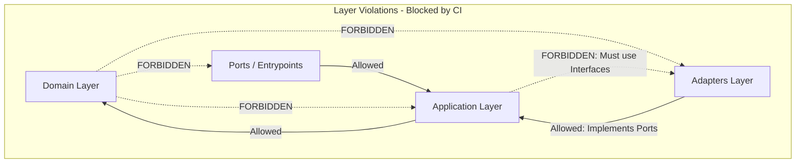

# Architecture Spine — Threadline Platform

This document serves as the binding architectural contract for the Threadline backend platform. It fixes the technical invariants, boundary rules, concurrency protocols, and data ownership guarantees required to allow independent microservices to be developed in Golang without architectural divergence (*drift*).

---

## 1. Design Paradigm

Each microservice is built strictly upon **Hexagonal Architecture (Ports & Adapters)**, combined globally with **Event-Driven CQRS** and **Distributed Saga Orchestration**.

```mermaid
graph TD
    subgraph Driving Adapters [Outside: Driving / Primary]
        HTTP[HTTP Handlers - Chi v5]
        gRPC_In[gRPC Handlers]
        Kafka_Consumer[Kafka Event Consumers]
    end

    subgraph Application Boundary [Inside: Application Layer]
        UseCases[Application Use Cases / Interactors]
        InPorts[Driving Ports: Interfaces exposed to Handlers]
        OutPorts[Driven Ports: Interfaces for Repositories & Clients]
    end

    subgraph Domain Core [Core: Domain Model - Pure Go]
        Entities[Domain Entities & Aggregates]
        ValueObjects[Value Objects: Money, SKU, Address]
        DomainEvents[Domain Events: StockReserved, OrderPaid]
        DomainErrors[Domain Errors: ErrInsufficientStock]
    end

    subgraph Driven Adapters [Outside: Driven / Secondary]
        PG[PostgreSQL Adapter - sqlc + pgxpool]
        RedisAdapter[Redis Lua Sharded Counter]
        Kafka_Producer[Kafka Publisher - franz-go]
        gRPC_Out[Downstream gRPC Clients]
    end

    Driving Adapters --> InPorts
    InPorts --> UseCases
    UseCases --> Entities
    UseCases --> OutPorts
    PG -.->|Implements| OutPorts
    RedisAdapter -.->|Implements| OutPorts
    Kafka_Producer -.->|Implements| OutPorts
    gRPC_Out -.->|Implements| OutPorts
```

### Layer Namespace & Directory Mapping

| Layer | Directory | Responsibilities & Allowed Dependencies |
|---|---|---|
| **Domain** | `internal/domain/` | Pure business rules, invariants, and aggregate roots. **Zero external dependencies** (Go stdlib only). No DB tags, no HTTP definitions. |
| **Application** | `internal/application/` | Orchestrates use cases, coordinates transactions, and declares **Ports (Go interfaces)** for persistence and external I/O. |
| **Driven Adapters** | `internal/adapters/` | Implements driven ports: PostgreSQL (`pgx`), Redis, Kafka, external API clients. |
| **Driving Ports & Adapters** | `internal/ports/` (or `internal/entrypoints/`) | HTTP handlers (`chi`), gRPC servers, consumer event routers, DTO serialization, and RFC 7807 error formatting. |
| **Entrypoints** | `cmd/api/`, `cmd/worker/` | Dependency injection container wire-up (`main.go`), configuration loading, graceful shutdown. |

---

## 2. Invariants & Rules

### AD-1 — Multi-Module Monorepo with Go Workspaces (`go.work`)
- **Binds:** Repository layout, CI pipelines, Docker builds, `pkg/` shared libraries.
- **Prevents:** Dependency bloat across microservices, transitive dependency vulnerabilities, and bloated Docker image layers.
- **Rule:** Each service and `pkg/` maintains its own isolated `go.mod`. Development utilizes `go.work` at the root. CI pipelines strictly enforce path-based building and testing (`paths-filter`) so changes to one service do not trigger dependency updates in others.

---

### AD-2 — Zero-Oversell Concurrency via Atomic SQL & Scheduled Hot-SKU Pre-Warming
- **Binds:** `inventory-service`, `catalog-service`, database schema, flash-sale promotions.
- **Prevents:** Negative stock quantities, overselling under 10,000 concurrent requests, and runtime split-brain between Redis and PostgreSQL.
- **Rule:** 
  1. Default inventory operations must execute single atomic conditional SQL updates:
     ```sql
     UPDATE stock_items
     SET reserved = reserved + $qty, version = version + 1, updated_at = now()
     WHERE tenant_id = $tenant_id AND sku = $sku AND warehouse_id = $warehouse_id
       AND (on_hand - reserved - damaged) >= $qty
     RETURNING version;
     ```
  2. Multi-SKU reservations must sort item IDs lexicographically before acquiring locks to guarantee zero deadlock.
  3. High-traffic flash-sale SKUs (>500 RPS) must be explicitly configured and pre-warmed into Redis sharded counters prior to campaign start. Dynamic, adaptive mid-flight stock migration from PostgreSQL to Redis during an active sale is strictly prohibited.

---

### AD-3 — Saga Pivot Transaction & Retry-Forward-Only Guarantee
- **Binds:** `order-service` (Saga Orchestrator), `payment-service`, `inventory-service`.
- **Prevents:** Financial reconciliation discrepancies, dual charges, and customer balance drift caused by post-capture failures.
- **Rule:**
  1. The checkout saga follows strict orchestration: `ReserveStock (Sync)` $\to$ `Authorize & Capture Payment (Sync)` $\to$ `Commit Stock (Async/Sync)`.
  2. `Capture Payment` is the formal **Pivot Transaction**. Once capture succeeds, compensation (rollback/refund) is forbidden within the automated saga path.
  3. All steps following a successful capture operate under **Retry-Forward-Only** semantics with exponential backoff and jitter. Unrecoverable failures route to a Dead Letter Queue (DLQ) and immediately page On-Call engineering.

---

### AD-4 — PostgreSQL Multi-Tenant RLS & Fail-Closed Session Scope
- **Binds:** All microservices utilizing PostgreSQL, database migration scripts, background workers.
- **Prevents:** Cross-tenant data leakage via pooled connection reuse or missed `WHERE tenant_id = $1` filters.
- **Rule:**
  1. All multi-tenant tables must have Row-Level Security enabled (`ENABLE ROW LEVEL SECURITY`) with policies enforcing `tenant_id = current_setting('app.tenant_id', true)`.
  2. Microservice connection pools must run queries inside explicit transactions starting with `SET LOCAL app.tenant_id = '<tenant>'`.
  3. Unset tenant contexts must evaluate to fail-closed (0 rows returned).
  4. Background workers must **not** possess `BYPASSRLS` privileges. Workers must iterate tenants sequentially, executing each tenant's batch within a dedicated transaction scoped via `SET LOCAL`.

---

### AD-5 — Entity-Scoped Kafka Partition Key Strategy
- **Binds:** Kafka producers, outbox publishers, topic configurations, event schemas.
- **Prevents:** Hot partition skew caused by tenant traffic imbalance while preserving strict per-entity causal ordering.
- **Rule:** All Kafka messages must use the specific entity ID (`order_id`, `sku`, `reservation_id`) as the partition key. Keying messages by `tenant_id` or emitting null keys on stateful domain topics is strictly forbidden.

---

### AD-6 — Logical Database-per-Service Isolation & Enforced Role Boundaries
- **Binds:** Database infrastructure, SQL migrations, microservice credentials.
- **Prevents:** Cross-service SQL joins, shared database coupling, and leaky boundaries.
- **Rule:** Every microservice owns a dedicated logical database (e.g., `threadline_order`, `threadline_inventory`) accessed by a dedicated PostgreSQL user. Cross-database queries and cross-user table grants are prohibited at the PostgreSQL catalog permission level.

---

### AD-7 — Zero Remote I/O Inside Database Transactions
- **Binds:** All application use cases, transaction middleware, database repositories.
- **Prevents:** PostgreSQL connection pool starvation, extended row-lock holding, and cascading failures under downstream degradation.
- **Rule:** Executing remote network operations (HTTP, gRPC, Redis, Kafka) inside an open PostgreSQL transaction is strictly prohibited. Database transactions must open, mutate state and Outbox records, and commit within sub-millisecond durations.

---

### AD-8 — Strict Idempotency with Payload Hashing & In-Flight Mutex
- **Binds:** API Gateway, `POST /v1/checkout`, payment capture/refund, external webhooks.
- **Prevents:** Duplicate financial charges, duplicate orders, and concurrent double fulfillment.
- **Rule:** 
  1. Stateful mutating requests require an `Idempotency-Key` header (UUIDv7).
  2. The system stores `(idempotency_key, tenant_id, request_hash, state, response_body)`.
  3. If an identical key arrives with a different SHA-256 payload hash, the server must return `422 Unprocessable Entity` (`IDEMPOTENCY_KEY_REUSED_WITH_DIFFERENT_PAYLOAD`).
  4. If a concurrent duplicate request arrives while the first is `IN_PROGRESS`, the server must return `409 Conflict`.

---

### AD-9 — End-to-End W3C Trace Context Propagation Across Outbox and Kafka
- **Binds:** API Gateway, gRPC middleware, Outbox table schemas, Kafka producers & consumers.
- **Prevents:** Broken distributed tracing spans across asynchronous messaging boundaries.
- **Rule:** 
  1. Ingress requests parse or generate W3C `traceparent` headers.
  2. All `outbox_events` tables must contain a `headers JSONB` column persisting the active `traceparent`.
  3. Outbox relays must inject this `traceparent` into Kafka Record Headers. Consumers must extract the header and instantiate a child OpenTelemetry span.

---

### AD-10 — Domain Purity Invariant
- **Binds:** All code inside `internal/domain/`.
- **Prevents:** Leaking transport, storage, and external framework concerns into domain core logic.
- **Rule:** The `domain` package must import standard library packages only. Any import of `database/sql`, `github.com/jackc/pgx`, `net/http`, or struct serialization tags (`json:`, `db:`) is prohibited and blocked in CI via `go-arch-lint`.

---

### AD-11 — Expand-Contract Zero-Downtime Database Migration
- **Binds:** All database schema changes and deployment procedures.
- **Prevents:** Production downtime and application errors during rolling canary deployments.
- **Rule:** Schema evolution must strictly follow the Expand/Contract phased model:
  1. *Expand:* Add nullable column or new table.
  2. *Dual-write:* Application writes to both old and new columns.
  3. *Backfill:* Async job backfills legacy rows.
  4. *Contract:* Application switches read to new column, stops writing to old, drops old column.
  All indexes must be created with `CREATE INDEX CONCURRENTLY`.

---

### AD-12 — Error Taxonomy & RFC 7807 Problem Details Standard
- **Binds:** All HTTP APIs, Gateway response formatting, error mapping layers.
- **Prevents:** Inconsistent error responses and internal database/stack-trace leakage.
- **Rule:** All client errors must return `Content-Type: application/problem+json` matching RFC 7807, containing `type`, `title`, `status`, `code`, `detail`, `instance`, and `trace_id`. Internal database errors and stack traces must never leak to HTTP clients.

---

## 3. Dependency Direction & Boundary Rule



---

## 4. Consistency Conventions

| Concern | Convention | Verification / Tooling |
|---|---|---|
| **Primary Keys** | `UUIDv7` (time-ordered, sortable, index-locality friendly). | `github.com/google/uuid` v7 |
| **Monetary Values** | `amount_minor BIGINT` (in lowest currency denomination, e.g. cents/cents/xu) + `currency CHAR(3)` (ISO 4217). **Floating point arithmetic is strictly forbidden.** | CI lint + Database Check Constraints |
| **Timestamps** | `TIMESTAMPTZ` in UTC. Formatted as ISO 8601 / RFC 3339 in APIs. | Database constraint |
| **Naming Conventions** | Go: `PascalCase` exported, `camelCase` internal. SQL: `snake_case` plural tables. JSON/REST: `snake_case`. Kafka topics: `threadline.{tenant}.{domain}.{event}.v{version}` | `golangci-lint` |
| **Pagination** | Keyset / Cursor-based pagination `(cursor = base64(last_val, last_id))` for public high-volume APIs. Offset pagination permitted only in Admin APIs with `offset <= 10000`. | API contract review |
| **Logging** | Structured JSON via Go `log/slog`. Mandatory keys: `timestamp`, `level`, `service`, `trace_id`, `span_id`, `tenant_id`, `msg`. No PII logging. | `pkg/observability` |
| **Metrics Taxonomy** | RED for services (`http_requests_total`, `http_request_duration_seconds_bucket`). Invariant probe: `oversell_detected_total` (alert immediately if $> 0$). | Prometheus Alertmanager |
| **API Versioning** | URI prefix `/v1/`. Breaking changes require `/v2/` and 6 months deprecation with HTTP `Deprecation` and `Sunset` headers. | `oasdiff` in CI |

---

## 5. Technology Stack Seed

| Layer / Technology | Pinned Version | Selection Rationale |
|---|---|---|
| **Language & Runtime** | `Go 1.23` | High concurrency, small memory footprint, distroless images (~15MB), fast startup (<3s). |
| **HTTP Router** | `go-chi/chi/v5` | Lightweight, 100% `net/http` idiomatic, zero heavy framework overhead. |
| **gRPC & RPC Tooling** | `google.golang.org/grpc` + `buf` | High-performance sync inter-service communication; `buf` prevents breaking schema changes. |
| **PostgreSQL Driver** | `jackc/pgx/v5` (`pgxpool`) | Native binary protocol, high throughput, robust connection hooks for RLS. |
| **SQL Generator** | `sqlc` | Type-safe Go code generated directly from reviewed SQL queries. Zero ORM overhead. |
| **Database Migrations**| `goose` / `atlas` | Sequential versioned SQL migrations; linted by `squawk` in CI. |
| **Cache & Sharding** | `redis/go-redis/v9` | Redis 7 cluster support, pipeline, atomic Lua execution. |
| **Message Streaming** | `twmb/franz-go` | Pure Go Kafka client without CGO dependencies; high performance and low memory allocations. |
| **Telemetry & Tracing**| `go.opentelemetry.io/otel` | Vendor-neutral OpenTelemetry instrumentation exporting to Collector via OTLP gRPC. |
| **Testcontainers** | `testcontainers-go` | Real PostgreSQL, Redis, Kafka instances spun up in Docker for deterministic integration tests. |

---

## 6. Structural Seed (Monorepo Layout)

```text
threadline/
├── go.work                          # Go Workspaces linking all services and pkg/
├── Makefile                         # make dev | test | lint | seed | load-test
├── docker-compose.yml               # Local stack: Postgres, Redis, Kafka, OTel, LocalStack
├── proto/                           # Protobuf specs governed by buf.yaml
│   ├── inventory/v1/inventory.proto
│   └── payment/v1/payment.proto
├── pkg/                             # Shared libraries (Go module: threadline/pkg)
│   ├── go.mod
│   ├── httpx/                       # RFC 7807 problem details, recovery, tenant parser
│   ├── grpcx/                       # Tracing interceptors, error mapping
│   ├── outbox/                      # Outbox table writer & relay interfaces
│   ├── rls/                         # pgxpool transaction hook for SET LOCAL app.tenant_id
│   ├── idempotency/                 # Idempotency middleware & validation
│   └── observability/               # slog JSON handler, OTel TracerProvider & MeterProvider
├── services/
│   ├── gateway/                     # API Gateway / BFF
│   ├── identity/                    # User authentication, JWT rotation, RBAC
│   ├── catalog/                     # Multi-tenant catalog, variants, categories
│   ├── inventory/                   # High-contention stock management & zero-oversell engine
│   │   ├── go.mod
│   │   ├── cmd/
│   │   │   ├── api/main.go
│   │   │   └── worker/main.go
│   │   ├── internal/
│   │   │   ├── domain/              # Aggregate roots, stock invariant logic
│   │   │   ├── application/         # ReserveStock, CommitStock, ports interfaces
│   │   │   ├── adapters/            # Postgres sqlc adapter, Redis Lua sharded counter
│   │   │   └── ports/               # gRPC server, HTTP endpoints
│   │   └── migrations/
│   ├── order/                       # Saga Orchestrator & state machine
│   ├── payment/                     # PSP mock adapters, webhook handlers
│   ├── fulfillment/                 # Allocation, shipment tracking, RMA returns
│   └── search/                      # OpenSearch CQRS read model
└── docs/
    └── architecture-threadline/
        ├── architecture-threadline.md # (This spine)
        └── .memlog.md
```

---

## 7. Capability → Architecture Mapping

| Backlog Epic | Primary Component | Governing Invariants |
|---|---|---|
| **EPC-01: Multi-Tenant Platform & Scaffolding** | `pkg/rls`, `gateway` | **AD-1, AD-4, AD-6, AD-12** |
| **EPC-02: Identity & Access Management** | `services/identity` | **AD-4, AD-12** |
| **EPC-03: Multi-Tenant Catalog** | `services/catalog` | **AD-4, AD-11, AD-12** |
| **EPC-04: High-Contention Inventory Engine** | `services/inventory` | **AD-2, AD-7, AD-10** |
| **EPC-05: Distributed Order Saga Orchestrator** | `services/order` | **AD-3, AD-7, AD-8, AD-10** |
| **EPC-06: Payment Integration & Webhooks** | `services/payment` | **AD-3, AD-8, AD-12** |
| **EPC-07: Transactional Outbox & Kafka Backbone**| `pkg/outbox`, Kafka | **AD-5, AD-7, AD-9** |
| **EPC-08: Fulfillment & RMA Returns** | `services/fulfillment` | **AD-3, AD-5, AD-9** |
| **EPC-09: OpenSearch CQRS Catalog Search** | `services/search` | **AD-5, AD-9** |
| **EPC-10: Observability, SLOs & Chaos Benchmark**| Cross-cutting / OTel | **AD-9, AD-12** |

---

## 8. Deferred Decisions

The following architectural choices are intentionally deferred to preserve system velocity without compromising integrity:

| Deferred Item | Revisit Trigger | Reason for Deferral |
|---|---|---|
| **Cell-Based Regional Sharding** | When single-region Aurora write latency exceeds 50ms at peak. | Multi-tenant RLS within a multi-AZ cluster is sufficient for 500-1,000 orders/s. Cell-based architecture prematurely balloons operational overhead. |
| **Multi-Cloud Disaster Recovery** | When business SLA demands RTO $< 5$ minutes across cloud providers. | AWS Multi-AZ Aurora + Cross-Region S3 backup fulfills current 99.95% SLO requirements. |
| **Machine Learning Recommendations** | Post-MVP when historical user interaction data exceeds 10M events. | High-throughput core transactional guarantees (inventory/orders) take priority over personalization. |
| **Production Carrier / PSP Integrations**| When moving from pilot staging to commercial launch. | High-fidelity mock adapters with contract testing (Pact) fully validate the architecture without vendor account friction. |

---

## 9. Appendix: Architectural Trade-Offs & Interview Defense (GFG / Big Tech)

### Q1: "Why 6 microservices instead of a Modular Monolith or 15 microservices?"
> *"I chose 6 services based on two core criteria: **rate of change** and **contention/scale profile**. Inventory has an entirely different write pattern (high row contention, atomic reservation locks) and traffic spikes 20x during flash sales compared to Catalog (which is 100:1 read-heavy and cached via CDN). Putting them together would couple their scaling policies and database connection pools. Conversely, I avoided splitting into 15 services (e.g., splitting cart or pricing) because doing so introduces network latency hops and distributed transaction complexity without operational benefit."*

### Q2: "How does Threadline guarantee zero oversell without table locks?"
> *"We use atomic conditional SQL updates in PostgreSQL with the invariant guard embedded inside the `WHERE` clause: `WHERE (on_hand - reserved - damaged) >= $qty`. Under PostgreSQL's `Read Committed` isolation level, when concurrent transactions attempt to update the same row, they queue behind row-level exclusive locks. When a lock is released, PostgreSQL triggers `EvalPlanQual`—re-evaluating the predicate against the newly committed row state. If stock was depleted by an earlier transaction, 0 rows are affected and the application receives an immediate `ErrInsufficientStock`. No lost updates occur, and no table locks are held."*

### Q3: "What happens if the service crashes right after charging the credit card in the Saga?"
> *"Payment Capture is our formal **Pivot Transaction**. Once the payment provider captures funds, the Saga shifts into **Retry-Forward-Only** mode. Rolling back via automated refund introduces severe financial risks if the refund fails or the bank rejects it. Instead, the Saga state is persisted in PostgreSQL with each step. When the pod restarts, the Saga poller discovers incomplete instances and retries forwarding actions (Commit Stock, Dispatch) with exponential backoff. If a permanent failure occurs, it routes to a Dead Letter Queue and triggers an urgent On-Call alert."*

### Q4: "Why use Outbox + Debezium CDC instead of Dual Writes (writing to DB then publishing to Kafka)?"
> *"Dual writes are an anti-pattern in distributed systems because dual-phase atomic commits between PostgreSQL and Kafka are impossible without 2PC, which destroys performance. If a service commits to Postgres but crashes before publishing to Kafka, the message is permanently lost. The Transactional Outbox pattern guarantees that state changes and domain events are persisted in the exact same ACID database transaction. Debezium CDC then tails the PostgreSQL WAL log asynchronously, providing guaranteed at-least-once publishing with sub-50ms latency."*

### Q5: "How do you prevent PostgreSQL connection pool exhaustion with RLS?"
> *"By strictly enforcing `SET LOCAL app.tenant_id = $1` inside an explicit transaction block. Unlike `SET`, `SET LOCAL` is scoped exclusively to the active transaction and automatically evaporates upon `COMMIT` or `ROLLBACK`. When the connection is returned to the pool (`pgxpool`), it carries zero lingering tenant state. Furthermore, background reconciliation workers do not bypass RLS; they iterate tenants sequentially with explicit local scoping to maintain defense-in-depth."*
